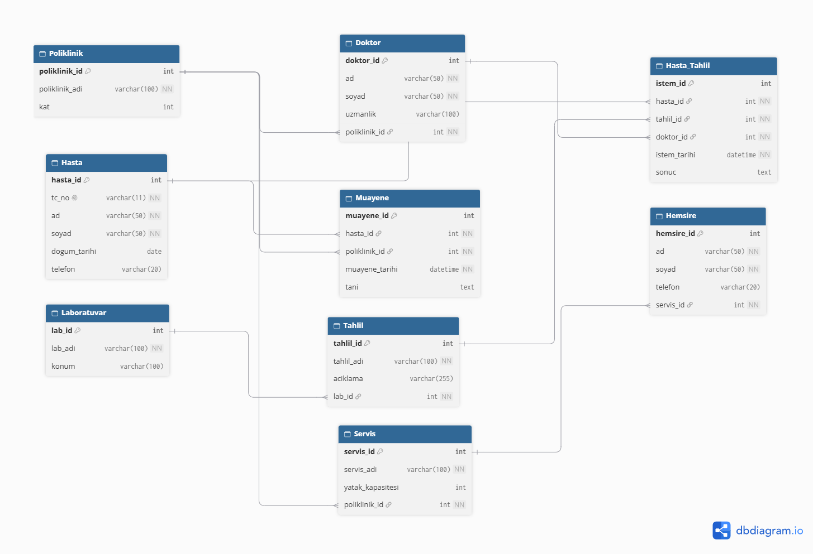

# 🏥 Veritabanı Yönetim Sistemleri - Ders Sonu Ödevi 1

Bu depo, **Veritabanı Yönetim Sistemleri** dersi kapsamında hazırlanan **Hastane Otomasyonu Prototipi** veritabanı tasarımını, klasik **Chen Varlık-İlişki (ER) diyagramını**, **İlişkisel Tablo Şemasını (dbdiagram)** ve **MSSQL (T-SQL)** betiğini içermektedir.

## 👥 Proje Ekibi

* **Yusuf Sercan İşçi** - 455142
* **İlhan Sami Adaklı** - 455116

## 📌 Problem Tanımı ve İş Kuralları

Ödev kapsamında belirtilen 7 varlık kümesi (**Hasta, Doktor, Poliklinik, Laboratuvar, Tahlil, Hemşire, Servis**) ve iş kuralları doğrultusunda kavramsal (Chen ER) ve fiziksel (İlişkisel Şema) tasarım kurgulanmıştır:

| Kural No | İş Kuralı | İlişki Türü | Fiziksel Tablo / Anahtar Karşılığı |
| :--- | :--- | :---: | :--- |
| **1** | Doktorlar polikliniklerde çalışır. Bir poliklinikte birden fazla doktor çalışabilir, bir doktor tek poliklinikte çalışır. | **1:N** | `Doktor` tablosunda `poliklinik_id` (FK) |
| **2** | Hastalar poliklinikte muayene olur. | **N:M** | `Muayene` ara tablosu (`muayene_id` PK, `hasta_id` FK, `poliklinik_id` FK, `muayene_tarihi`, `tani` + ek karar olarak `doktor_id` FK) |
| **3** | Hastalar tahlil yaptırabilir, tahlilleri doktorlar ister. (`Tahlil` tablosu tahlil kataloğunu/türünü tutar.) | **N:M (Üçlü)** | `Hasta_Tahlil` ara tablosu (`istem_id` PK, `hasta_id` FK, `doktor_id` FK, `tahlil_id` FK, `istem_tarihi`, `sonuc`) |
| **4** | Tahliller laboratuvarda yapılır, bir tahlil iki farklı laboratuvarda yapılmaz. | **1:N** | `Tahlil` tablosunda `lab_id` (FK) |
| **5** | Hemşireler servislerde çalışır. Bir serviste birden fazla hemşire olabilir, aynı hemşire iki farklı servise hizmet vermez. | **1:N** | `Hemsire` tablosunda `servis_id` (FK) |
| **6** | Servisler polikliniklere aittir. Bir polikliniğin birden fazla servisi olabilir. | **1:N** | `Servis` tablosunda `poliklinik_id` (FK) |

## 📐 1. Klasik Varlık-İlişki (Chen ER) Diyagramı

Kavramsal modellemede **Chen notasyonu** kullanılmıştır:

* **Dikdörtgenler:** Varlık kümelerini (`HASTA`, `POLİKLİNİK`, `DOKTOR`, `SERVİS`, `HEMŞİRE`, `TAHLİL`, `LABORATUVAR`) temsil eder.
* **Baklava Dilimleri (Eşkenar Dörtgenler):** Varlıklar arasındaki ilişkileri (`ÇALIŞIR`, `MUAYENE OLUR`, `TAHLİL İSTER`, `YAPILIR`, `GÖREV YAPAR`, `AİTTİR`) ve iki uçtaki kardinaliteleri (**1 / N / M**) gösterir.
* **Elipsler:** Her varlığın ve N:M ara tabloların (`Muayene`, `Hasta_Tahlil`) özniteliklerini gösterir; **birincil anahtarlar (PK) altı çizili** olarak belirtilmiştir.

## 🗺️ 2. İlişkisel Veritabanı Tablo Şeması (dbdiagram.io)

Chen ER diyagramından dönüştürülen fiziksel tablolar, birincil anahtarlar (PK) ve yabancı anahtar (FK) bağlantıları aşağıda modellenmiştir:

> **Tasarım Notu:** Ödev kuralında Hasta–Poliklinik arası **N:M** (`Muayene`) ilişkisi tanımlanmıştır. Gerçek hastane işleyişinde muayeneyi gerçekleştiren hekimin de izlenebilmesi adına `Muayene` tablosuna opsiyonel (`NULL` geçilebilir) `doktor_id` yabancı anahtarı ek bir tasarım kararı olarak dahil edilmiştir.

## 🛠️ Kullanılan Teknolojiler ve Standartlar

* **Veritabanı Motoru:** Microsoft SQL Server (MSSQL / T-SQL)
* **Yönetim Aracı:** SQL Server Management Studio (SSMS)
* **Tasarım Araçları:** Klasik Chen ER Notasyonu & dbdiagram.io
* **Veri Tipleri & Kurallar:**
  * Kimlik alanlarında `IDENTITY(1,1)` ile otomatik artan tekil anahtarlar kullanılmıştır.
  * Türkçe karakter uyumluluğu için metin alanlarında `NVARCHAR` standardı benimsenmiştir.
  * T.C. Kimlik numarası `CHAR(11)` ve `UNIQUE` kısıtıyla korunmuştur.
  * Tablolar arası referans bütünlüğü isimlendirilmiş `FOREIGN KEY` kısıtları ile garanti altına alınmıştır.

## 📂 Depo İçeriği

* `hastane_chen_er_diyagrami.png`: Varlık, ilişki, öznitelik, altı çizili PK ve kardinaliteleri içeren klasik Chen ER diyagramı.
* `hastane_er_diyagrami.png`: İlişkisel tablo şemasını (PK/FK) gösteren dbdiagram görseli.
* `hastane_veritabani_semasi.sql`: Veritabanını, tabloları ve tüm kısıtları oluşturan çalıştırılabilir T-SQL betiği.
